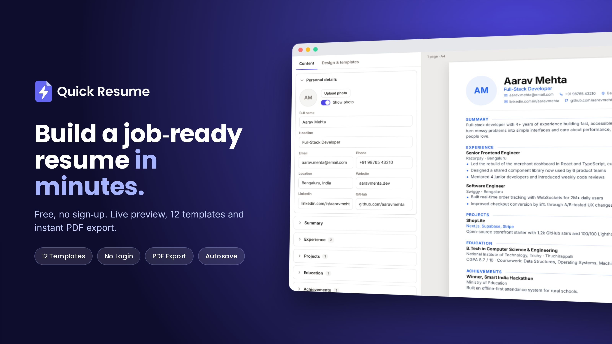

<p align="center">
  
</p>

<p align="center">
  <b>Build a job-ready resume in minutes. Free, no sign-up, no backend.</b>
</p>

<p align="center">
  <a href="#features">Features</a> •
  <a href="#tech-stack">Tech Stack</a> •
  <a href="#project-structure">Project Structure</a> •
  <a href="#author">Author</a>
</p>

<p align="center">
  
  
  
  
  
</p>



## About

**Quick Resume** is a fast, privacy-friendly resume builder that runs entirely in your browser. Pick a template, fill in your details, watch the live preview update as you type, and download a clean PDF. You don't need an account, and your data never leaves your device.

It's built with plain HTML, CSS and vanilla JavaScript. There are no frameworks, no dependencies and no build step.

🔗 **Live demo:** [quick-resume-gray.vercel.app](https://quick-resume-gray.vercel.app/)

## Features

- 🎨 **12 templates**: Modern, Classic, Minimal, Sidebar, Two Column, Executive, Creative, ATS Plain, Timeline, Compact Tech, Elegant and Bold
- 👀 **Live preview** side by side, with an Edit/Preview toggle on mobile and page-break guides
- 🖌️ **Customisation**: accent colours (presets or a custom picker), 9 fonts, spacing density, text size, and A4 or US Letter paper
- 🧩 **All the sections you need**: personal info and photo, summary, experience, education, projects, skills with levels, certifications, languages, links, plus unlimited custom sections
- ↕️ **Full control**: add, delete (with undo) and reorder entries, and reorder or hide whole sections
- 💾 **Autosave** to localStorage, so nothing is lost on refresh
- 📄 **PDF export** with selectable text, clickable links and correct page breaks
- 🔁 **Import/Export JSON** to back up your resume or move it to another device
- 🔒 **No login, no tracking, no server.** Your data stays in your browser.
- 📱 **Fully responsive**, so it works on phones, tablets and desktops

## Tech Stack

| Layer   | Tech                                   |
|---------|----------------------------------------|
| UI      | HTML5, CSS3                            |
| Logic   | Vanilla JavaScript (ES6+)              |
| Storage | Browser localStorage                   |
| PDF     | Browser print engine (Save as PDF)     |
| Fonts   | Self-hosted Google Fonts (SIL OFL)     |

## Project Structure

```
quick-resume/
├── site/
│   ├── index.html      # App shell
│   ├── app.js          # App logic and DEV_CONFIG
│   ├── app.css         # Editor UI styles
│   ├── resume.css      # Resume templates and print styles
│   ├── fonts.css       # Font declarations
│   ├── fonts/          # Self-hosted fonts
│   └── favicon.svg
├── test/               # Playwright QA scripts
└── README.md
```

## Contributing

Contributions, issues and feature requests are welcome!

1. Fork the project
2. Create your branch (`git checkout -b feature/amazing-feature`)
3. Commit your changes (`git commit -m "Add amazing feature"`)
4. Push to the branch (`git push origin feature/amazing-feature`)
5. Open a Pull Request

## License

Distributed under the MIT License. See `LICENSE` for details.

## Author

**Tanay Biswas**

- 🌐 Portfolio: [tanaybiswas.me](https://tanaybiswas.me)
- 💻 GitHub: [@Tanay8n](https://github.com/Tanay8n)
- 💼 LinkedIn: [tanay-biswas-8n](https://www.linkedin.com/in/tanay-biswas-8n?utm_source=share_via&utm_content=profile&utm_medium=member_android)
- 📧 Email: tanay8@gmail.com

---

<p align="center">If you found this useful, consider giving it a ⭐</p>
